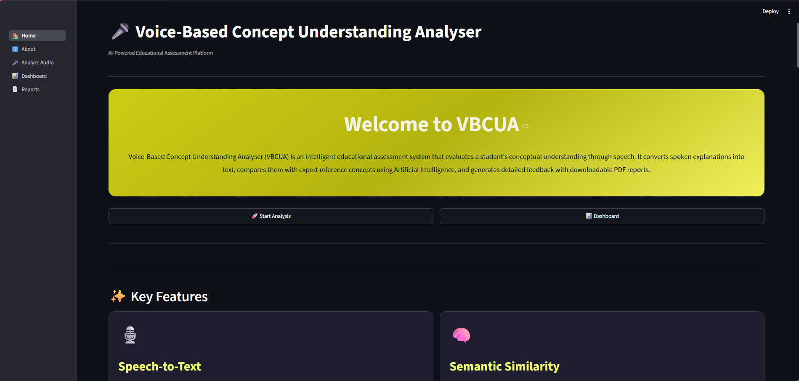
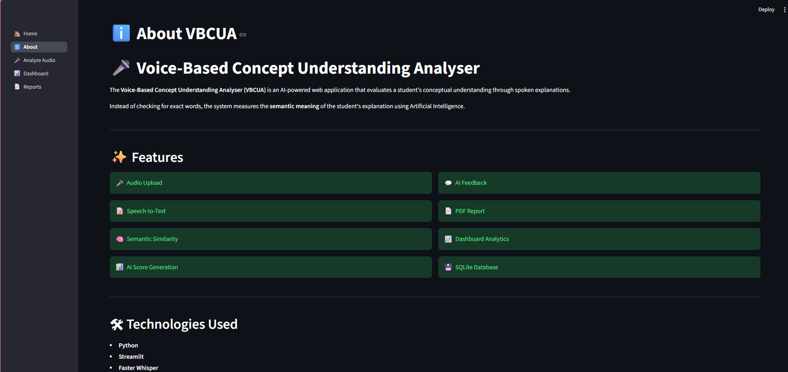
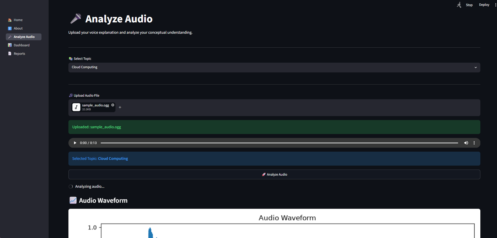
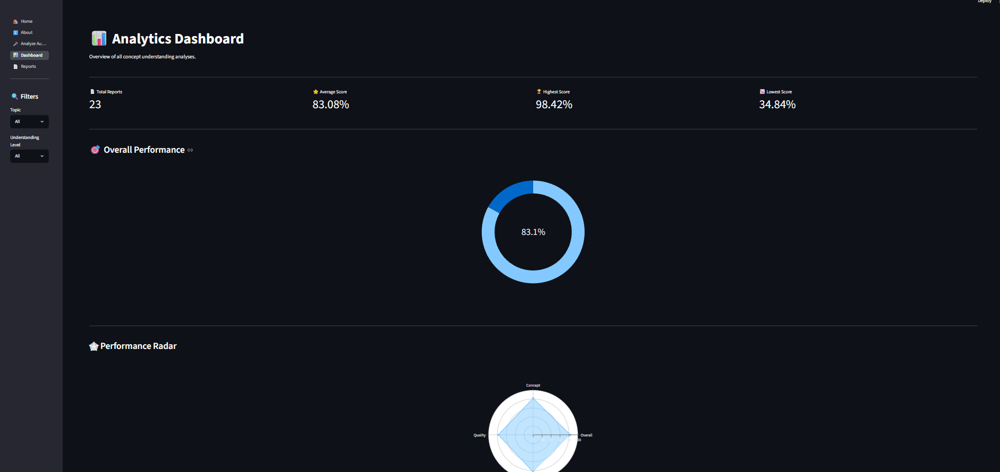
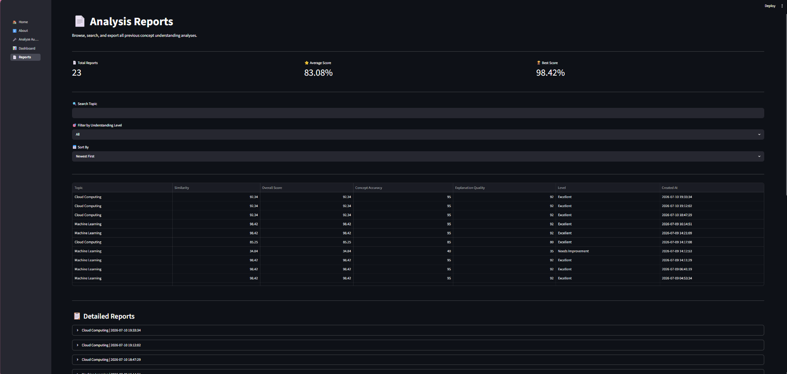

# 🎤 Voice-Based Concept Understanding Analyser (VBCUA)

An AI-powered educational assessment platform that evaluates a student's conceptual understanding through spoken explanations instead of simple keyword matching.

The system converts speech into text using **Faster Whisper**, compares the explanation with expert reference concepts using **Sentence-BERT**, analyzes conceptual understanding, generates intelligent feedback, stores results in a SQLite database, and creates downloadable PDF reports.

---

# 📌 Project Overview

Voice-Based Concept Understanding Analyser (VBCUA) is designed to improve concept-based learning by evaluating the semantic meaning of a student's explanation rather than checking for exact words.

Students upload an audio explanation of one of the supported topics. The system automatically performs speech transcription using Faster Whisper, semantic similarity using Sentence-BERT, keyword matching, scoring, AI feedback generation, dashboard visualization, and PDF report generation.

---

# ✨ Features

- 🎤 Audio Upload
- 📝 Speech-to-Text using Faster Whisper
- 🧠 Semantic Similarity using Sentence-BERT
- 🔑 Keyword Matching
- 📊 AI-Based Score Calculation
- 💬 Intelligent Feedback Generation
- 📄 Downloadable PDF Reports
- 📈 Dashboard Analytics
- 💾 SQLite Database Storage
- 🎨 Responsive Streamlit Interface
- 🌙 Dark & Light Theme Support

---

# 📚 Supported Topics

The current version of VBCUA supports concept evaluation for:

- 🤖 Machine Learning
- ☁️ Cloud Computing
- 🧠 Artificial Intelligence
- 📊 Data Science
- 🗄️ Database Management System
- 💻 Operating System


# ⚙️ System Workflow

```text
Upload Audio
      │
      ▼
Speech Transcription
(Faster Whisper)
      │
      ▼
Load Reference Concept
      │
      ▼
Semantic Similarity
(Sentence-BERT)
      │
      ▼
Keyword Matching
      │
      ▼
Score Calculation
      │
      ▼
AI Feedback
      │
      ▼
Store Results
(SQLite)
      │
      ▼
Generate PDF Report
      │
      ▼
Dashboard Analytics
```

---

# 🛠️ Technologies Used

## Programming

- Python
- Streamlit

## Artificial Intelligence

- Faster Whisper
- Sentence-BERT
- Transformers

## Database

- SQLite

## Libraries

- Librosa
- Torch
- Plotly
- Matplotlib
- ReportLab

---

# 📂 Project Structure

```text
VBCUA/
│
├── api/
├── assets/
│   ├── images/
│   └── styles/
│       └── custom.css
│
├── audio/
│   ├── uploads/
│   ├── processed/
│   └── waveforms/
│
├── database/
│   ├── database.py
│   ├── database.db
│   └── queries.py
│
├── models/
│   ├── whisper_model.py
│   ├── semantic_model.py
│   ├── audio_analysis.py
│   ├── keyword_match.py
│   ├── scoring.py
│   └── feedback.py
│
├── pages/
│   ├── About.py
│   ├── Home.py
│   ├── Analyze_Audio.py
│   ├── Dashboard.py
│   └── Reports.py
│
├── reference_concepts/
│
├── reports/
│
├── tests/
│
├── utils/
│
├── app.py
├── requirements.txt
├── runtime.txt
└── README.md
```

---

# 🚀 Installation

## Clone the Repository

```bash
git clone https://github.com/YOUR_USERNAME/VBCUA.git
```

```bash
cd VBCUA
```

---

## Create Virtual Environment

### Windows

```bash
python -m venv .venv
```

Activate:

```bash
.venv\Scripts\activate
```

---

## Install Dependencies

```bash
pip install -r requirements.txt
```

---

## Run the Application

```bash
streamlit run app.py
```

---

# 🧪 Testing

The project includes unit tests for major modules.

```text
tests/
│
├── test_audio_analysis.py
├── test_whisper_model.py
├── test_semantic_model.py
├── test_keyword_match.py
└── test_database.py
```

Run tests individually:

```bash
python tests/test_audio_analysis.py
```

```bash
python tests/test_whisper_model.py
```

```bash
python tests/test_semantic_model.py
```

```bash
python tests/test_keyword_match.py
```

```bash
python tests/test_database.py
```

---

# 📊 Output

The application generates:

- Speech Transcript
- Semantic Similarity Score
- Keyword Matching Score
- Overall AI Score
- Personalized Feedback
- Dashboard Analytics
- Downloadable PDF Report

---

# 🚀 Future Enhancements

- 🎙️ Live Voice Recording
- 🌍 Multi-language Support
- 🤖 AI Chatbot Tutor
- ☁️ Cloud Deployment
- 👨‍🎓 Student Login System
- 👨‍🏫 Teacher Dashboard
- 📈 Performance Prediction
- 📚 More Academic Subjects

---

# 👨‍💻 Developer

**SHAIK PATTA BIBI AYESHA**

Final Year B.Tech (Computer Science & Engineering)

VOICE-BASED CONCEPT UNDERSTANDING ANALYSER [VBCUA]


---

# 📄 License

This project is licensed under the MIT License.

See the LICENSE file for more details.


# 📷 Application Screenshots

<p align="center">
  
  
</p>

<p align="center">
  
  
</p>

<p align="center">
  
</p>